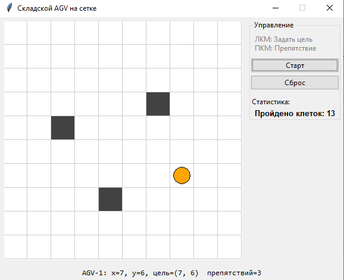

Министерство науки и высшего образования Российской Федерации

Федеральное государственное автономное образовательное учреждение
высшего образования

«Омский государственный технический университет»

Кафедра «Автоматизация и робототехника»

 

 

 

 

 

 

 

 

**Отчет**

по дисциплине «Программирование на языке Python»

Лабораторная работа №5.

«Объектно-ориентированное программирование (ООП) в приложении с оконным
интерфейсом»

 

 

 

 

 

 

 

 

 

 

 

 

Выполнил: ст. гр. УТС-251т

Курячий Андрей

Проверил:

доц., к.н. Ситников Д.В

Омск 2026

1\. Цель работы

Изучить основы объектно-ориентированного программирования в Python
(классы, инкапсуляция, наследование, полиморфизм) и получить
практические навыки разработки настольного приложения с графическим
интерфейсом на базе библиотеки Tkinter для контроля мехатронного объекта
(складского робота AGV).

2\. Формулировка индивидуального задания

Вариант 10. Складской AGV на сетке.\
Необходимо реализовать:

Классы модели: GridMap (размер сетки, координаты препятствий), AGV
(базовый алгоритм движения к цели напролом, подсчёт шагов), SmartAGV
(наследник класса AGV, реализующий алгоритм обхода препятствий).

Графический интерфейс (Tkinter): Поле Canvas с отображением клеточной
карты склада. Щелчок левой кнопкой мыши (ЛКМ) задаёт координаты целевой
точки, щелчок правой кнопкой мыши (ПКМ) устанавливает/удаляет
препятствие. Интерфейс должен включать кнопку «Старт / Пауза» для
симуляции, а также выводить текстовый счётчик пройденных роботом клеток.

3\. Реализация принципов ООП в коде:

Инкапсуляция: Атрибуты цели робота \_target_x и \_target_y защищены.
Доступ к ним реализован через свойство \@property def target. В сеттере
target проверяются корректность координат (нахождение в пределах сетки)
и отсутствие препятствия в выбранной клетке. В случае нарушения условий
генерируется исключение ValueError.

Наследование: Класс SmartAGV наследует функционал базового класса AGV.
Инициализация базового класса выполняется через вызов
super().\_\_init\_\_(name, grid_map).

Полиморфизм: Метод step() переопределен в дочернем классе SmartAGV.
Базовый робот ходит строго по осям напрямую, тогда как умный робот
вычисляет свободные ячейки и пытается обойти возникшую преграду вбок.
Графическое окно вызывает метод .step() полиморфно, не зная точного типа
переданного робота.

4\. Макет окна приложения и перечень виджетов

Интерфейс приложения разделён на две основные зоны (с использованием
менеджера компоновки grid): холст для отрисовки и панель управления
\[cite: 1\].

Используемые виджеты: \[cite: 1\]

tk.Canvas: Двумерное игровое поле размером 400x400 пикселей для
визуализации сетки склада (10х10 клеток), препятствий (серые квадраты),
целевой точки (красный крестик) и робота (оранжевый круг).

ttk.LabelFrame: Боковая панель сгруппированных элементов управления с
заголовком \"Управление\".

ttk.Label: Текстовые метки для вывода статической инструкции по
управлению мышью, а также для отображения динамических переменных
состояния.

ttk.Button: Интерактивные кнопки «Старт / Пауза» (запуск симуляции через
метод after) и «Сброс» (очистка карты и возвращение робота в начальную
позицию).

Привязка управления к Canvas осуществляется событиями \<Button-1\> (ЛКМ
--- установка цели) и \<Button-3\> (ПКМ --- установка стены) \[cite:
1\].

5\. код программы

import tkinter as tk

from tkinter import ttk, messagebox

class GridMap:

\"\"\"Модель сетки склада с препятствиями.\"\"\"

def \_\_init\_\_(self, size=10):

self.size = size

self.obstacles = set() \# Множество кортежей (x, y)

def is_free(self, x, y):

\"\"\"Проверка, свободна ли ячейка и находится ли в границах
склада.\"\"\"

return 0 \<= x \< self.size and 0 \<= y \< self.size and (x, y) not in
self.obstacles

class AGV:

\"\"\"Модель базового складского робота.\"\"\"

def \_\_init\_\_(self, name, grid_map):

self.name = name

self.grid_map = grid_map

self.reset()

def reset(self):

self.x = 0

self.y = 0

self.\_target_x = None

self.\_target_y = None

self.steps_count = 0

\@property

def target(self):

\"\"\"Возвращает кортеж цели или None.\"\"\"

if self.\_target_x is None:

return None

return self.\_target_x, self.\_target_y

\@target.setter

def target(self, value):

\"\"\"Установка цели с проверкой корректности (Инкапсуляция).\"\"\"

if value is None:

self.\_target_x = None

self.\_target_y = None

return

tx, ty = value

if not (0 \<= tx \< self.grid_map.size and 0 \<= ty \<
self.grid_map.size):

raise ValueError(f\"Цель выходит за границы сетки
0\...{self.grid_map.size-1}\")

if (tx, ty) in self.grid_map.obstacles:

raise ValueError(\"Нельзя установить цель на клетку с препятствием!\")

self.\_target_x = tx

self.\_target_y = ty

def step(self):

\"\"\"Один шаг моделирования (базовое движение напролом).\"\"\"

if self.target is None or (self.x == self.\_target_x and self.y ==
self.\_target_y):

return False

if self.x != self.\_target_x:

self.x += 1 if self.\_target_x \> self.x else -1

elif self.y != self.\_target_y:

self.y += 1 if self.\_target_y \> self.y else -1

self.steps_count += 1

return True

def \_\_str\_\_(self):

target_str = f\"({self.\_target_x}, {self.\_target_y})\" if self.target
else \"нет\"

return f\"{self.name}: x={self.x}, y={self.y}, цель={target_str}\"

class SmartAGV(AGV):

\"\"\"Умный робот: умеет делать шаг вбок при обнаружении
препятствия.\"\"\"

def \_\_init\_\_(self, name, grid_map):

super().\_\_init\_\_(name, grid_map)

def step(self):

\"\"\"Один шаг моделирования с обходом препятствий (Полиморфизм).\"\"\"

if self.target is None or (self.x == self.\_target_x and self.y ==
self.\_target_y):

return False

dx = 1 if self.\_target_x \> self.x else (-1 if self.\_target_x \<
self.x else 0)

dy = 1 if self.\_target_y \> self.y else (-1 if self.\_target_y \<
self.y else 0)

\# 1. Пробуем пройти по X

if dx != 0 and self.grid_map.is_free(self.x + dx, self.y):

self.x += dx

\# 2. Пробуем пройти по Y

elif dy != 0 and self.grid_map.is_free(self.x, self.y + dy):

self.y += dy

\# 3. Обход препятствия (вынужденный шаг в сторону по свободной оси Y)

elif dx != 0 and self.grid_map.is_free(self.x, self.y + 1):

self.y += 1

elif dx != 0 and self.grid_map.is_free(self.x, self.y - 1):

self.y -= 1

else:

return False \# Путь полностью заблокирован

self.steps_count += 1

return True

class WarehouseApp(tk.Tk):

\"\"\"Главное окно приложения интерфейса.\"\"\"

SCALE = 40

SIZE = 400

DT = 0.3

def \_\_init\_\_(self, grid_map, robot):

super().\_\_init\_\_()

self.title(\"Складской AGV на сетке\")

self.resizable(False, False)

self.grid_map = grid_map

self.robot = robot

self.running = False

self.info = tk.StringVar()

self.steps_var = tk.StringVar(value=\"Пройдено клеток: 0\")

self.\_build_widgets()

self.\_redraw()

self.after(int(self.DT \* 1000), self.\_tick)

def \_build_widgets(self):

self.canvas = tk.Canvas(self, width=self.SIZE, height=self.SIZE,
bg=\"white\")

self.canvas.grid(row=0, column=0, padx=5, pady=5)

panel = ttk.LabelFrame(self, text=\"Управление\")

panel.grid(row=0, column=1, sticky=\"n\", padx=5, pady=5)

instructions = \"ЛКМ: Задать цель\\nПКМ: Препятствие\"

ttk.Label(panel, text=instructions, justify=\"left\",
foreground=\"gray\").pack(anchor=\"w\", padx=5, pady=5)

self.btn_start = ttk.Button(panel, text=\"Старт\",
command=self.\_toggle)

self.btn_start.pack(fill=\"x\", pady=2)

ttk.Button(panel, text=\"Сброс\", command=self.\_reset).pack(fill=\"x\",
pady=2)

ttk.Label(panel, text=\"Статистика:\").pack(anchor=\"w\", pady=(8, 0))

ttk.Label(panel, textvariable=self.steps_var, font=(\"Arial\", 10,
\"bold\")).pack(anchor=\"w\", padx=5)

ttk.Label(self, textvariable=self.info, font=(\"Consolas\",
10)).grid(row=1, column=0, columnspan=2, pady=5)

self.canvas.bind(\"\<Button-1\>\", self.\_on_canvas_left_click)

self.canvas.bind(\"\<Button-3\>\", self.\_on_canvas_right_click)

def \_on_canvas_left_click(self, event):

gx = event.x // self.SCALE

gy = event.y // self.SCALE

try:

self.robot.target = (gx, gy)

self.\_redraw()

except ValueError as err:

messagebox.showerror(\"Ошибка\", str(err))

def \_on_canvas_right_click(self, event):

gx = event.x // self.SCALE

gy = event.y // self.SCALE

if (gx, gy) != (self.robot.x, self.robot.y) and (gx, gy) !=
self.robot.target:

if (gx, gy) in self.grid_map.obstacles:

self.grid_map.obstacles.remove((gx, gy))

else:

self.grid_map.obstacles.add((gx, gy))

self.\_redraw()

def \_toggle(self):

self.running = not self.running

self.btn_start.config(text=\"Пауза\" if self.running else \"Старт\")

def \_reset(self):

self.running = False

self.btn_start.config(text=\"Старт\")

self.robot.reset()

self.grid_map.obstacles.clear()

self.\_redraw()

def \_tick(self):

if self.running and self.robot.target:

moved = self.robot.step()

self.\_redraw()

if not moved:

self.running = False

self.btn_start.config(text=\"Старт\")

if (self.robot.x, self.robot.y) == self.robot.target:

messagebox.showinfo(\"Внимание\", \"Робот успешно прибыл в цель\")

else:

messagebox.showwarning(\"Внимание\", \"Путь заблокирован
препятствиями!\")

self.after(int(self.DT \* 1000), self.\_tick)

def \_redraw(self):

cv, r = self.canvas, self.robot

cv.delete(\"all\")

for i in range(self.grid_map.size):

for j in range(self.grid_map.size):

x1, y1 = i \* self.SCALE, j \* self.SCALE

x2, y2 = x1 + self.SCALE, y1 + self.SCALE

fill_color = \"#424242\" if (i, j) in self.grid_map.obstacles else
\"white\"

cv.create_rectangle(x1, y1, x2, y2, fill=fill_color, outline=\"#ccc\")

if r.target:

tx, ty = r.target

x1, y1 = tx \* self.SCALE + 10, ty \* self.SCALE + 10

x2, y2 = (tx + 1) \* self.SCALE - 10, (ty + 1) \* self.SCALE - 10

cv.create_line(x1, y1, x2, y2, fill=\"red\", width=2)

cv.create_line(x1, y2, x2, y1, fill=\"red\", width=2)

rx = r.x \* self.SCALE + self.SCALE // 2

ry = r.y \* self.SCALE + self.SCALE // 2

cv.create_oval(rx - 14, ry - 14, rx + 14, ry + 14, fill=\"orange\",
outline=\"black\")

self.steps_var.set(f\"Пройдено клеток: {r.steps_count}\")

self.info.set(f\"{r} препятствий={len(self.grid_map.obstacles)}\")

def main():

grid_map = GridMap(size=10)

robot = SmartAGV(\"AGV-1\", grid_map)

app = WarehouseApp(grid_map, robot)

app.mainloop()

if \_\_name\_\_ == \"\_\_main\_\_\":

main()

6\. Результаты работы

Программа успешно протестирована в различных режимах симуляции:

1.  Штатный сценарий движения: При клике ЛКМ на пустую клетку
    выставляется красная метка цели. После нажатия кнопки «Старт» робот
    корректно совершает перемещения с частотой, заданной через метод
    after(300, \...). При прибытии в цель выдаётся диалоговое окно
    messagebox.showinfo. Счётчик шагов работает корректно.

2.  Обход препятствий: При расстановке стен с помощью ПКМ робот SmartAGV
    не останавливается перед одиночным препятствием, а успешно обходит
    его сбоку, продолжая путь. Если путь полностью заблокирован по всем
    фронтам, срабатывает условие останова симуляции и выводится
    messagebox.showwarning(\"Внимание\", \"Путь заблокирован
    препятствиями!\").

3.  Обработка некорректных действий (Try/Except): Попытка задать цель в
    точку, где установлено препятствие, отслеживается валидатором
    свойства target. Ошибка перехватывается блоком try/except в
    графическом интерфейсе и выводится пользователю через окно
    предупреждения messagebox.showerror, исключая аварийное завершение
    скрипта \[cite: 1\].

7\. Выводы

В ходе выполнения лабораторной работы были успешно освоены базовые
механизмы объектно-ориентированного программирования (ООП) на языке
Python. Реализовано разделение программы на независимые логические
уровни (моделирование физической сетки/робота и графическое
представление). На практике закреплены навыки создания неблокирующих
таймеров в событийно-ориентированных средах с помощью встроенного метода
виджетов .after() вместо стандартного time.sleep(), нарушающего работу
главного цикла mainloop().
